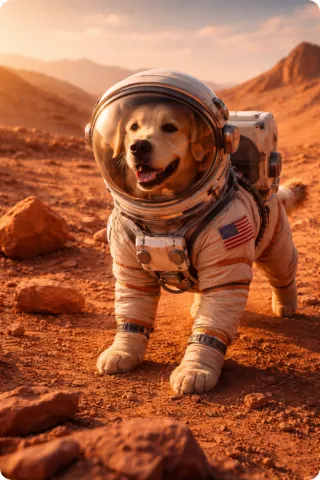
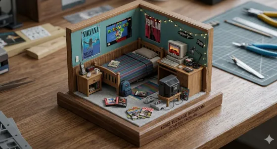
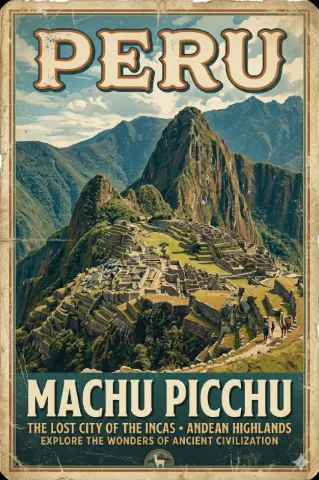

# 🚀 PurePrompts

[](LICENSE)
[](http://makeapullrequest.com)
[](https://nextjs.org/)
[](https://tailwindcss.com/)

> Welcome to **PurePrompts** — an open-source AI Prompts Gallery ecosystem dedicated to discovering, organizing, and sharing high-quality prompts for various AI models like ChatGPT, Gemini, and Claude.

## [🌐 View in Web Gallery](http://localhost:3000) | [🏷️ Browse by Category](http://localhost:3000/categories)

---

## 📖 Table of Contents

- [🤔 What is PurePrompts?](#-what-is-pureprompts)
- [✨ Key Features](#-key-features)
- [🔥 Featured Prompts](#-featured-prompts)
- [💻 Getting Started (Local Dev)](#-getting-started-local-dev)
- [🤝 How to Contribute](#-how-to-contribute)
- [📄 License & Acknowledgements](#-license--acknowledgements)

---

## 🤔 What is PurePrompts?

PurePrompts is a curated community gallery designed to help you extract the absolute best out of LLMs and generative AI. Whether you need a prompt to act as a Linux Terminal, a creative copywriter, or an expert programmer, this library provides ready-to-use templates.

---

## ✨ Key Features

- **Categorized Prompts**: Browse through specific domains like Coding, Images, and General assistants.
- **Advanced Filtering & Search**: Find the exact prompt matching your use case seamlessly.
- **Dynamic Views**: Switch between grid and list layouts for improved readability.
- **Image Prompt Builder**: A dedicated toolkit for crafting complex image generation prompts.
- **Responsive Design**: Fast and mobile-friendly interface optimized for all screen sizes.

---

## 🔥 Featured Prompts

Here are some of the community's favorite prompts available in the project's data layer:

### ✨ No. 1: POV: Peaking Into The Crater Of A Volcano



> **Prompt**: "A photorealistic POV image of a person peaking into the crater of a volcano. They are wearing weathered gloves and gripping onto the rocks in the foreground. Smoke is billowing out of the volcano. The location is a volcanic crater. Keep it in a 3:2 aspect ratio."  
> **Category**: Images

### ✨ No. 2: Double Exposure: Wolf Howling


> **Prompt**: "Create a double exposure image on a white background blending a silhouette of a wolf howling and a snowy forest under moonlight. The scene is contained within the silhouette."  
> **Category**: Images

### ✨ No. 3: Isometric Diorama: 1990s Teenage Bedroom



> **Prompt**: "Generate a photorealistic image of a diorama, make sure it is isometric. It is of a 1990s teenage bedroom. Add objects related to retro gaming and posters but keep it minimalistic. The diorama sits on a wooden base."  
> **Category**: Images

### ✨ No. 4: Vintage Poster: Machu Picchu, Peru



> **Prompt**: "Generate a vintage travel poster of Machu Picchu, Peru. Include the name 'PERU' and 'MACHU PICCHU'. Worn texture, weathered edges. 2:3 format."  
> **Category**: Images

---

## 💻 Getting Started (Local Dev)

Want to run the gallery locally? PurePrompts is built with the **Next.js App Router**.

First, install dependencies and run the development server:

```bash
npm install
npm run dev
# or yarn dev / pnpm dev / bun dev
```

Open [http://localhost:3000](http://localhost:3000) with your browser to see the result. You can start editing the project by modifying `src/app/page.tsx`.

---

## 🤝 How to Contribute

We love contributions! The easiest way to contribute is by adding new high-quality prompts to our JSON data files located in `src/data/`.

1. **Fork the repository**
2. **Add your prompt** to `src/data/external-prompts.json` or `src/data/external-image-prompts.json` following the existing schema.
3. **Submit a Pull Request** with a descriptive title!

### 🐛 Found a Bug?

If you've spotted a UI issue or a broken link, please [open an issue](https://github.com/ariel-projects/prompts-catalog-mit/issues).

---

## 📄 License & Acknowledgements

This project is licensed under the **MIT License**. See the [LICENSE](LICENSE) file for details.

- **Framework**: [Next.js](https://nextjs.org/)
- **Styling**: [Tailwind CSS](https://tailwindcss.com/)
- **Icons**: [Lucide React](https://lucide.dev/)

### ⭐ Support the Project

If you find these prompts useful, please consider giving this repository a **Star**! It helps the project grow and reach more developers and creators.
